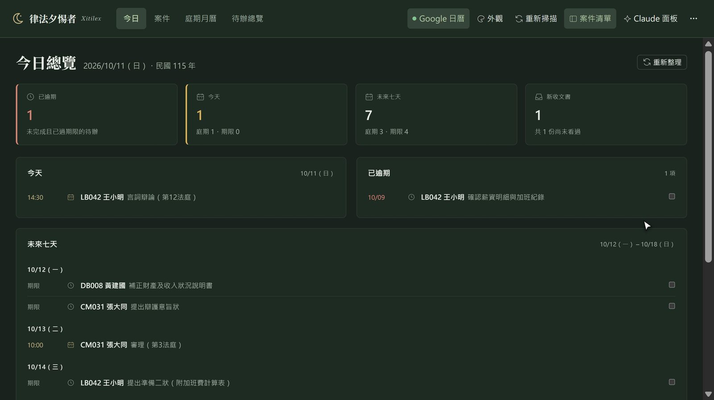
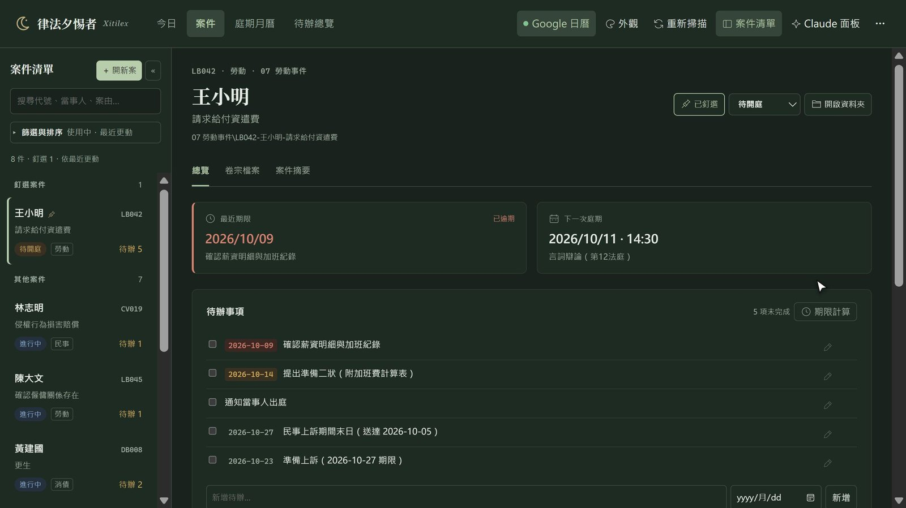
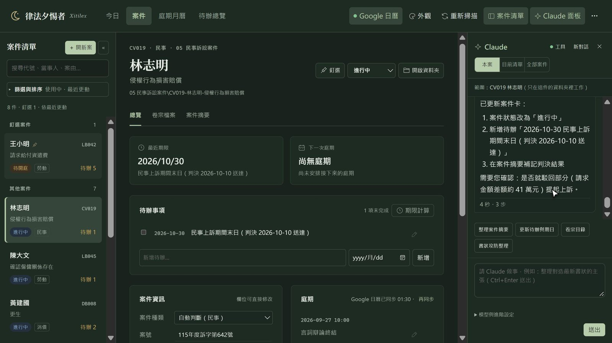
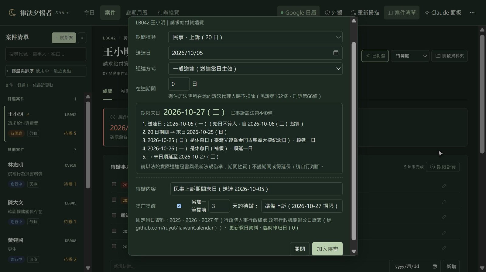
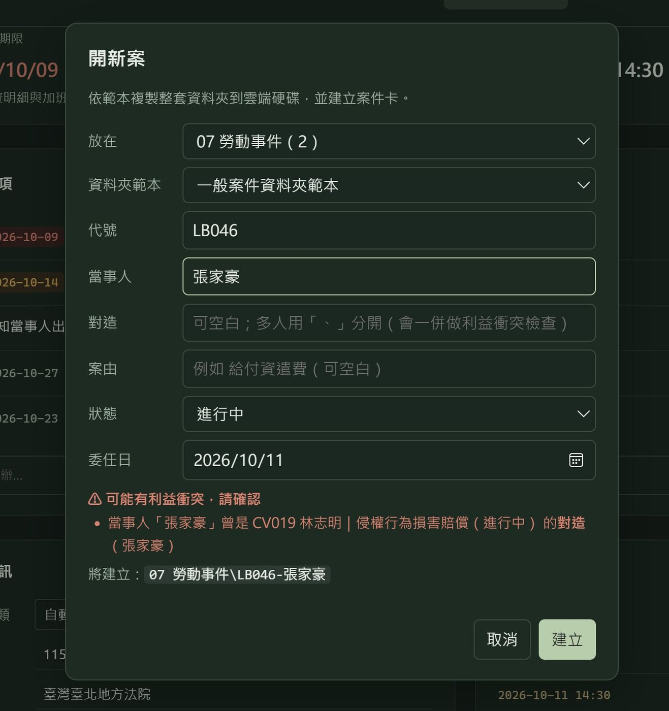
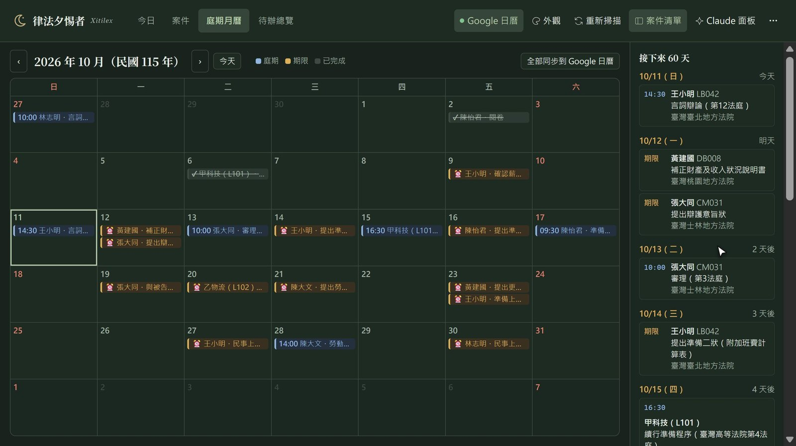
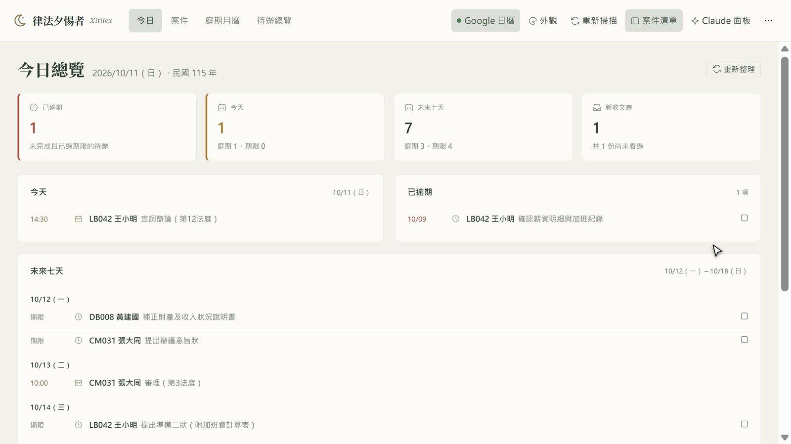

# Xitilex (律法夕惕者)

> *Vigilantibus, non dormientibus, iura subveniunt.* — The law assists the vigilant, not those who sleep.

**A case workbench for lawyers in Taiwan.** Xitilex reads the case folders you already keep on your computer
(or Google Drive) and turns them into a workbench: case status, hearings and deadlines, to-dos, case files,
a statutory-deadline calculator, new-document alerts, conflict-of-interest checks, Google Calendar sync —
and lets you ask [Claude Code](https://www.anthropic.com/claude-code) to read and organize a case right inside it —
with your own skills, MCP servers and claude.ai connectors available, not just a chat box.

The interface is in Traditional Chinese and the deadline rules follow Taiwanese procedural law.
[中文說明](README.md)



https://github.com/user-attachments/assets/08ab6da7-5fcd-414c-a4af-6c8b8434087c

> All cases and names in the screenshots are fictional demo data.

## How it works

No database, no import. Each case's status, hearings and to-dos live in a plain Markdown file (`_案件卡.md`)
inside that case's own folder, readable in Obsidian or any text editor. Xitilex scans the folders, shows them as a
workbench, writes changes back to those files, and lets Claude work on the same files.

## Features

- **Today** — today's hearings and deadlines, overdue to-dos, the next seven days (with public holidays), new documents.
- **Case page** — next deadline / next hearing at a glance, inline editing of to-dos and hearings, case summary, files open in their default app.
- **Statutory deadline calculator** — 19 common periods (civil, non-contentious, family, debt clearance, criminal, administrative); deposit / public service, travel days, holiday roll-over using the official government office calendar; adds the deadline as a to-do.
- **New-document alerts** — notices new files in a case folder; one click asks Claude to read a judgment or notice and record hearings and deadlines.
- **Conflict check** — matches clients, opposing parties and case notes across all cases when opening a new case.
- **Claude Code integration** — works with the case folder as its working directory, or across a filtered list / all cases. Conservative by default: no deleting, moving or renaming files unless you explicitly allow it for the current case.
- **Your whole Claude toolkit, inside each case** — Xitilex drives the Claude Code you have already set up, so most of your **skills, MCP servers and claude.ai connectors** (Gmail, Google Calendar, Google Drive, case-law search…) work right in the case panel. The "工具" (Tools) dialog lists what is available. Actions with outside effects — sending mail, changing calendar events, sharing or deleting files — are blocked by default.
- **Google Calendar** — one-way sync of hearings and deadlines; rescheduling updates the original event.
- **Native window** — tabs, multiple windows, zoom, collapsible sidebar, several themes. Works across several PCs via Google Drive.

## Screenshots

| Case page | Claude reads a new judgment and records the appeal deadline |
|---|---|
|  |  |
| **Statutory deadline calculator** | **Conflict check when opening a case** |
|  |  |
| **Hearing calendar** | **Paper theme** |
|  |  |

## Requirements

Windows 10/11, Python 3.10+. Optional: Claude Code (logged in), Google Drive for desktop, a Google Cloud OAuth client for calendar sync.

## Download & install

| File | For |
|---|---|
| [`Xitilex-v1.0.0-windows.zip`](https://github.com/ulysses5976/Xitilex/releases/latest) | Windows 10/11: unzip and run `安裝.exe` (the installer) |

1. Install [Python 3.10+](https://www.python.org/downloads/windows/) (tick "Add python.exe to PATH").
2. Download the zip from [Releases](https://github.com/ulysses5976/Xitilex/releases/latest) and unzip it where you want to keep the program.
3. Run **`安裝.exe`** (the installer). It installs the Python packages, finds your case folder, checks the Claude Code
   login and creates a 律法夕惕者 shortcut on the desktop and Start menu.

> [!NOTE]
> **Windows may show "Windows protected your PC".**
> The app is not code-signed, so Windows SmartScreen may warn you the first time you run it. Click **More info → Run anyway**.
> The full source code is public, so you can also [build it yourself](#build-from-source).

On first run `config.json` is created from `config.example.json`; open it in Notepad and set at least `owner_name` and
`root` (your case root folder), then restart the program.

### Build from source

```bat
git clone https://github.com/ulysses5976/Xitilex.git
cd Xitilex
launcher\build.cmd
安裝.exe
```

You can also run `pythonw run.py` directly, or `python run.py --browser`.

See the Chinese README for the case-card format, Claude permissions, Google Calendar setup and multi-PC use.

## Disclaimer

Deadline calculations and Claude's output are for reference only; always check the actual service records and current law. This project does not provide legal advice.

## License

[MIT](LICENSE) © 2026 無名小律師 (Attorney Yang Chao-Yuan)
