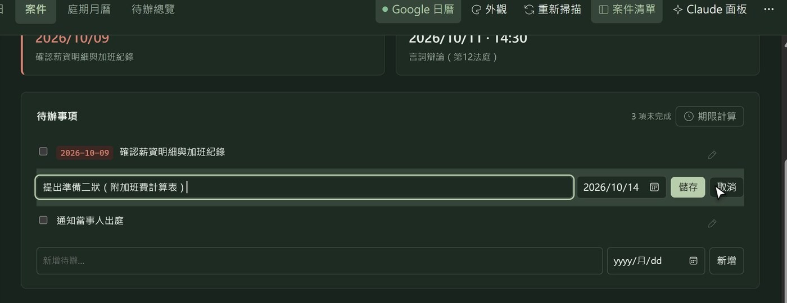

# 律法夕惕者 Xitilex

> *Vigilantibus, non dormientibus, iura subveniunt.*　法律幫助夕惕者，不幫助沉睡的人。
> 君子終日乾乾，夕惕若厲。——《易經・乾卦》

**律師的案件工作台。** 直接讀你電腦（或 Google 雲端硬碟）裡的案件資料夾：案件狀態、庭期與期限、
待辦、卷宗檔案、法定期間計算、新收文書提醒、利益衝突檢查、Google 日曆同步，
並可以在案件裡直接吩咐 [Claude Code](https://www.anthropic.com/claude-code) 讀卷、整理、更新進度。

[English](README.en.md)


https://github.com/user-attachments/assets/08ab6da7-5fcd-414c-a4af-6c8b8434087c


> 畫面中的案件、當事人與內容全部是虛構的示範資料。

## 為什麼做這個

案件資料本來就放在一個個資料夾裡（`LB042-王小明-請求給付資遣費`）。律法夕惕者不搬資料、不建資料庫：
每件案子的狀態、庭期、待辦就寫在該案資料夾裡的一個 Markdown 檔（`_案件卡.md`），
用 Obsidian、記事本都能打開；系統只是把它們整理成一個好用的工作台，並讓 Claude 能在同一份資料上幫忙。

## 功能

| | |
|---|---|
| **今日總覽** | 開程式先看今天的庭期、期限、已逾期待辦、未來七天（標出國定假日）與新收文書；可直接勾選完成 |
| **案件頁** | 總覽（最近期限、下一次庭期）、待辦與庭期就地修改、案件資訊、案件摘要直接打字、卷宗檔案用預設程式開啟 |
| **法定期間計算** | 民事、非訟、家事、消債、刑事、行政共 19 種常用期間；寄存／公示送達、在途期間、遇假日順延（行政院人事行政總處辦公日曆），一鍵加入待辦 |
| **新收文書提醒** | 案件資料夾出現新文件時提醒；一鍵請 Claude 讀取判決、通知書，把庭期與期限寫進案件卡 |
| **利益衝突檢查** | 開新案時比對所有案件的當事人、對造、子案對造與案件卡內文 |
| **Claude 整合** | 以該案資料夾為工作目錄，能讀 PDF／Word、寫整理文件、更新案件卡；也能一次處理「目前清單」或「全部案件」。權限預設保守（見下方） |
| **Google 日曆** | 庭期與期限單向同步到你指定的日曆；改期會更新原事件，不會重複 |
| **庭期月曆、待辦總覽** | 跨案件的月曆與待辦清單 |
| **原生視窗** | Windows 獨立視窗，多分頁、多視窗、Ctrl＋＋／－ 縮放、可收起的左欄；墨綠／宣紙等多種配色 |
| **多台電腦** | 程式與案件放在雲端硬碟，幾台電腦共用同一份 |

## 操作畫面

### 一、開程式先看「今日總覽」

今天的庭期與期限、已逾期的待辦、未來七天（國定假日會標出來）、有新文件的案件，一頁看完。
點案件名稱就打開該案；待辦右邊的方框可以直接勾選完成（畫面如本頁最上方）。

### 二、案件頁：一件案子，一頁看完

上方「最近期限／下一次庭期」一眼可見；下面是待辦、案件資訊、庭期與案件摘要，欄位都可以直接修改。
卷宗檔案在「卷宗檔案」分頁，點檔名就用電腦預設的程式開啟。


待辦與庭期按右邊的鉛筆（或在文字上點兩下）就地修改，Enter 存檔：



### 三、新收文書：判決一進來，交給 Claude

案件資料夾出現新文件時，案件頁最上方會提示（清單上也有數字）。按「請 Claude 讀取並更新庭期、期限」：


Claude 讀完判決，依送達日算出上訴期間末日寫進待辦、在摘要補記判決結果，並列出需要你確認的地方：


### 四、法定期間計算

選期間種類、填送達日，算出末日並列出每一步：始日不算入、遇週末或國定假日順延（例如 10/25 光復節、10/26 補假）。
可以一鍵加入待辦，另加提前幾天的提醒。


### 五、開新案先查利益衝突

填當事人與對造時即時比對所有案件；當事人曾是別案對造、或對造是本所別案當事人，會出現紅色警示。


### 六、庭期月曆與外觀

跨案件的庭期月曆（右側是接下來 60 天的議程），同步到 Google 日曆。外觀有墨綠案頭（預設）、宣紙案頭等多種配色。

| 庭期月曆 | 宣紙案頭配色 |
|---|---|
|  |  |

## 系統需求

- Windows 10／11（原生視窗用內建的 Edge WebView2；其他系統可用 `--browser` 以瀏覽器開啟，未完整測試）
- Python 3.10 以上
- 選用：[Claude Code](https://www.anthropic.com/claude-code)（Claude 相關功能；需要 Claude 訂閱並在命令列登入）
- 選用：Google 雲端硬碟電腦版（多台電腦共用）、Google Cloud OAuth 用戶端（日曆同步）

## 下載與安裝

| 檔案 | 適用 |
|---|---|
| [`Xitilex-v1.0.0-windows.zip`](https://github.com/ulysses5976/Xitilex/releases/latest) | Windows 10／11：解壓縮後執行 `安裝.exe` |

1. 先安裝 [Python 3.10 以上](https://www.python.org/downloads/windows/)（安裝時勾選「Add python.exe to PATH」）。
2. 到 [Releases](https://github.com/ulysses5976/Xitilex/releases/latest) 下載 zip，解壓縮到你想放程式的地方
   （要多台電腦共用的話，放在 Google 雲端硬碟裡）。
3. 雙擊 **`安裝.exe`**：它會安裝 Python 套件、記下 Python 位置、找案件資料夾、檢查 Claude Code 登入，
   並建立桌面與開始功能表的「律法夕惕者」捷徑。之後從捷徑或 `律法夕惕者.exe` 開啟。

> [!NOTE]
> **Windows 可能會跳出「Windows 已保護您的電腦」**
> 因為程式沒有付費的數位簽章，第一次執行時 Windows SmartScreen 可能會提醒。請按「其他資訊」→「仍要執行」。
> 原始碼全部公開，不放心的話可以[自行編譯](#自行編譯)。

第一次啟動時會從 `config.example.json` 建立 `config.json`，請用記事本打開，至少改兩項（改完重開程式）：

```jsonc
{
  "owner_name": "王大明律師",        // Claude 會以「王大明律師的案件管理系統」自稱
  "root": "{drive}\\案件"             // 案件根目錄；{drive}＝程式所在雲端硬碟的根目錄，也可以直接寫 D:\\案件
}
```

### 自行編譯

```bat
git clone https://github.com/ulysses5976/Xitilex.git
cd Xitilex
launcher\build.cmd
```

`build.cmd` 用 Windows 內建的 .NET 編譯器產生 `律法夕惕者.exe`（啟動程式）與 `安裝.exe`，接著同樣執行 `安裝.exe`
（或 `py -3 install.py`）。不想建 exe 也可以直接執行：`pythonw run.py`（原生視窗）或 `python run.py --browser`（瀏覽器）。

## 案件資料夾與案件卡

系統依資料夾名稱認出案件（可放在根目錄下的分類資料夾裡，最多三層）：

- 代號型：`CV021-陳怡君-返還借款`、`LB042A-王小明-請求給付資遣費`（字首決定案件種類：CV 民事、CM 刑事、FA 家事、LB 勞動…，可在案件頁改）
- 日期型：`20261008-周小姐`、`1151008-周小姐`（陪偵、義辯等）

每件案子的資料寫在該資料夾的 `_案件卡.md`（第一次在系統上編輯時才建立，掃描本身不寫任何檔案）：

```markdown
---
案件狀態: 待開庭
案號: 115年度勞訴字第88號
法院: 臺灣臺北地方法院
對造: 大發科技股份有限公司
下次期日: 2026-10-28 14:30 言詞辯論（第12法庭）   ← 系統依「庭期」自動計算
---

# LB042 王小明 請求給付資遣費

## 庭期
- 2026-10-28 14:30 言詞辯論（第12法庭） <!--gcal:cd…-->

## 待辦事項
- [ ] 2026-10-21 提出準備書狀 <!--gcal:cd…-->
- [x] 閱卷

## 案件摘要
- 案情：……
```

系統寫回時只重產 frontmatter、「庭期」「待辦事項」（與在案件頁編輯的「案件摘要」）段，其他段落逐字保留。
行尾的 `<!--gcal:…-->` 是 Google 日曆事件編號，改期時請保留。一件案子底下有多個訴訟時，可加「## 子案」段
（每行 `- L101 甲科技`），庭期與待辦以子案號開頭即可。

開新案時可依範本複製整套資料夾（範本放在根目錄的 `各種案件資料夾範本\`，名稱可在設定改）。

## Claude 整合與權限

需要先安裝 Claude Code 並在一般 PowerShell 執行 `claude` → `/login`。系統在背景以命令列呼叫它，
工作目錄設在該案資料夾，沿用你的訂閱額度與 skill。

- **預設不得刪除、搬移、改名檔案**（系統提示要求，`rm`、`Remove-Item`、`Rename-Item` 等指令也被封鎖）。
  要請它整理資料夾時，在面板「模型與進階設定」勾選「允許整理檔案」：只限本案資料夾（與 Obsidian 筆記庫），
  先列計畫等你同意，要刪的先搬進 `_待刪除\`；換案件或重開程式自動取消。
- 連接器預設不放行：只開放確認為唯讀的查詢；Gmail 只能讀信與建草稿、Google 日曆與雲端硬碟只能讀。
  規則在 `backend/claude_runner.py`。
- Obsidian 筆記庫（`vault_path`）：可讀、新增與修改筆記。

## Google 日曆同步

1. 在 [Google Cloud Console](https://console.cloud.google.com/) 建專案、啟用 Google Calendar API，
   建立「OAuth 用戶端 ID」（應用程式類型：電腦版應用程式），下載 JSON 存成 `data/credentials.json`。
2. 系統右上「Google 日曆」→「連結 Google 日曆」，在瀏覽器授權。
3. 選擇庭期與期限要寫入哪個日曆。之後在系統或由 Claude 改了案件卡，會自動在背景同步。

同步是單向的（案件卡 → 日曆）；授權 token 存在 `%LOCALAPPDATA%\casedesk\`，不會放進程式資料夾。

## 多台電腦

把程式資料夾放在 Google 雲端硬碟裡，每台電腦各執行一次 `安裝.exe` 即可共用：
案件卡、設定、Claude 對話紀錄（`data/chats/`）會同步；Google 授權與本機路徑（`%LOCALAPPDATA%\casedesk\local.json`）每台各自一份。
`config.json` 的路徑可用 `{drive}` 代表雲端硬碟根目錄，各台使用者名稱不同也沒關係。

## 隱私

- 伺服器只綁 `127.0.0.1`，不對外開放，沒有帳號系統；所有資料留在你自己的資料夾與雲端硬碟。
- 會連外的只有：Google 日曆同步（你授權時）、Claude Code（你吩咐 Claude 時）、下載國定假日資料（jsDelivr）。
- `.gitignore` 已排除 `config.json`、`data/credentials.json`、對話紀錄等個人資料。

## 注意

- 法定期間計算與 Claude 的整理結果**僅供參考**，請以實際送達證書、卷證與最新法規為準。本專案不提供法律意見。
- 期間種類的條號依 2026 年法規整理；法規修正時請自行核對。

## 開發

```bat
pip install -r requirements.txt
python tests/serve_ui_fixture.py --work-dir C:\Temp\xitilex-test --port 8895
```

以虛構案件啟動真的後端與前端（Claude 回覆為模擬）。測試時可用環境變數把資料導到測試資料夾：
`CASEDESK_ROOT`、`CASEDESK_DATA`、`CASEDESK_VAULT`、`CASEDESK_GCAL=off`、`CASEDESK_PORT`。

架構：FastAPI（`backend/`）＋原生 JavaScript 前端（`frontend/`）＋ pywebview 原生視窗（`run.py`）＋ C# 啟動程式（`launcher/`）。

## 授權

[MIT](LICENSE) © 2026 無名小律師（楊朝淵律師）

外觀設計部分由 Codex 協助製作；國定假日資料來自行政院人事行政總處「政府行政機關辦公日曆表」（經 [ruyut/TaiwanCalendar](https://github.com/ruyut/TaiwanCalendar)）。
